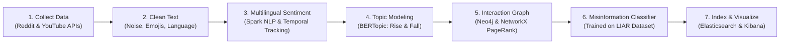

# Large-Scale Social Media Intelligence Platform

[](https://www.python.org/downloads/)
[](LICENSE)

An enterprise-grade, end-to-end data science platform that collects massive volumes of posts from social networks, cleans text and emojis, performs multilingual transformer sentiment analysis over time, tracks dynamic topic evolution with BERTopic, builds interaction graphs in Neo4j with NetworkX PageRank influencer ranking, trains misinformation classifiers on the LIAR dataset, and indexes enriched data in Elasticsearch with pre-built Kibana dashboards.

---

## 🛠️ Required Tech Stack

This project strictly utilizes the required technologies specified:
- **Reddit & YouTube APIs**: Data ingestion respecting rate limits and terms of use.
- **Spark NLP**: Multilingual transformer sentiment analysis and temporal tracking.
- **BERTopic**: Topic discovery and dynamic topic modeling (`topics_over_time`).
- **NetworkX**: PageRank algorithm for influencer ranking and community detection.
- **Neo4j**: Persistent graph database storing nodes (`:User`, `:Post`) and interaction relationships.
- **Elasticsearch**: Distributed search engine with custom mappings and bulk indexing.
- **Kibana**: Interactive dashboards for search, sentiment trends, topic evolution, and alerts.

---

## 📋 Step-by-Step Pipeline (Exact Execution Order)



1. **Step 1: Collect Data**
   - Reddit API (`data_collection/reddit_collector.py`) and YouTube Data API v3 (`data_collection/youtube_collector.py`).
   - Strictly enforces rate limits (exponential backoff) and terms of use (custom User-Agent headers).
   - Stores raw, unmodified payloads in `data/raw/reddit/` and `data/raw/youtube/`.
2. **Step 2: Clean Text**
   - Removes noise: URLs, HTML entities, and noisy mentions (`preprocessing/text_cleaner.py`).
   - Handles emojis: Demojizes into descriptive textual tokens preserving sentiment context.
   - Detects language: Identifies language codes (en, es, fr, de, hi, etc.) via `langdetect`.
   - Saves clean structured records to `data/processed/clean_posts.json`.
3. **Step 3: Multilingual Sentiment Analysis**
   - Multilingual transformer sequence classification using Spark NLP (`sentiment_analysis/sentiment_analyzer.py`).
   - Evaluates sentiment scores in `[-1.0, 1.0]` across diverse languages.
   - Tracks net sentiment indices aggregated over continuous temporal intervals (`sentiment_trends.json`).
4. **Step 4: BERTopic Topic Modeling**
   - Extracts semantic topic clusters and keywords (`topic_modeling/topic_modeler.py`).
   - Dynamic Topic Modeling: Computes `topics_over_time` to identify which topics are **rising** vs. **falling**.
5. **Step 5: User-Interaction Graph & Influencer Ranking**
   - Ingests user interactions into Neo4j (`graph_analysis/neo4j_manager.py`) with Cypher queries.
   - Calculates **PageRank** and runs **Community Detection** in NetworkX (`graph_analysis/networkx_analyzer.py`).
   - Syncs PageRank scores and community IDs back to Neo4j User nodes.
6. **Step 6: Misinformation / Fake-News Classifier**
   - Trains a calibrated classifier on the **LIAR benchmark dataset** (`misinformation_detection/misinformation_classifier.py`).
   - Evaluates on test split: Accuracy, Precision, Recall, F1, and Confusion Matrix.
   - Scores incoming posts with continuous misinformation risk probabilities.
7. **Step 7: Elasticsearch & Kibana Dashboards**
   - Custom index schema with type mappings (`indexing_and_dashboard/elasticsearch_indexer.py`).
   - Bulk indexes all enriched records and exports NDJSON payloads.
   - Pre-packaged Kibana Saved Objects (`indexing_and_dashboard/kibana_dashboard.json`) for search, trends, and alerts.

---

## 🚀 Quickstart & Setup Guide

### 1. Prerequisites
- Python 3.11+
- (Optional for live containers) Docker & Docker Compose

### 2. Environment Setup
```powershell
# Clone the repository
git clone https://github.com/your-username/social-media-intelligence-platform.git
cd social-media-intelligence-platform

# Create virtual environment
uv venv --python 3.11
.venv\Scripts\activate

# Install dependencies
uv pip install -r requirements.txt
```

### 3. Configure Credentials (Optional)
Copy `.env.example` to `.env` to supply live API keys:
```powershell
copy .env.example .env
```
*(If credentials are omitted, the platform automatically switches to the included reference datasets for seamless offline demonstration).*

### 4. Start Infrastructure (Docker Compose)
To launch local Neo4j, Elasticsearch, and Kibana instances:
```powershell
docker compose up -d
```
- **Neo4j Browser**: `http://localhost:7474` (User: `neo4j`, Password: `intelligence_password`)
- **Elasticsearch**: `http://localhost:9200`
- **Kibana**: `http://localhost:5601`

---

## 🏃 Running the Pipeline

Execute all 7 steps end-to-end:
```powershell
python main.py --run-all
```

To run individual steps modularly:
```powershell
# Step 1: Collect raw data
python data_collection/collector_runner.py --sources reddit youtube --limit 20

# Step 2: Clean text and detect language
python preprocessing/text_cleaner.py

# Step 3: Run multilingual sentiment analysis & tracking
python sentiment_analysis/sentiment_analyzer.py

# Step 4: Run BERTopic topic modeling
python topic_modeling/topic_modeler.py

# Step 5: Build interaction graph & rank influencers
python graph_analysis/networkx_analyzer.py

# Step 6: Train LIAR misinformation classifier
python misinformation_detection/misinformation_classifier.py

# Step 7: Index into Elasticsearch
python indexing_and_dashboard/elasticsearch_indexer.py

# Format and generate presentable reports (CSVs, Executive Summary, HTML Dashboard)
python main.py --present
```

---

## 📊 Presentable Data Outputs & Reports

The platform automatically structures and formats all processed data outputs into presentation-ready artifacts located in `data/processed/`:

1. **🌐 Interactive HTML Dashboard (`data/processed/intelligence_dashboard.html`)**:
   - Self-contained, responsive analytics dashboard viewable in any web browser without needing a running server.
   - Features KPI metric cards, interactive filterable tables, temporal sentiment curves, BERTopic rise/fall momentum badges, PageRank influencer leaderboards, and a misinformation audit panel.
2. **📝 Executive Summary Report (`data/processed/EXECUTIVE_SUMMARY.md`)**:
   - Comprehensive GitHub-flavored markdown report summarizing dataset KPIs, multilingual sentiment distributions, detected languages, dominant themes, top influencers, and model evaluation metrics.
3. **📁 Structured CSV Tables (`data/processed/tables/`)**:
   - `master_intelligence_dataset.csv`: Complete consolidated dataset spanning all 7 steps.
   - `clean_posts_summary.csv`: Step 2 noise-filtered text, emoji extractions, and language tags.
   - `sentiment_trends_temporal.csv`: Step 3 time-bucketed polarity scores and net sentiment indexes.
   - `topic_dynamics_rise_fall.csv`: Step 4 BERTopic dynamic trajectories, velocities, and trend status.
   - `influencer_leaderboard.csv`: Step 5 NetworkX PageRank scores, community IDs, and interaction degrees.
   - `misinformation_audit_report.csv`: Step 6 high-risk claims audit with probability meters and classification labels.

---

## 🧪 Running Automated Tests

Run the complete test suite verifying all 7 steps:
```powershell
python -m unittest discover -s tests -p "test_*.py" -v
```

---

## 📊 Kibana Dashboard Import

1. Open Kibana at `http://localhost:5601`.
2. Navigate to **Stack Management** > **Saved Objects**.
3. Click **Import** and select `indexing_and_dashboard/kibana_dashboard.json`.
4. Open the **Executive Social Media Intelligence Platform Dashboard** to explore:
   - Full-text search and filtering table
   - Dynamic sentiment trend lines over time
   - Rising and falling topic histograms
   - PageRank influencer leaderboards
   - Automated misinformation alert gauges

---

## 📁 Repository Structure

```
social-media-intelligence-platform/
├── config.py                          # Global configuration and path definitions
├── docker-compose.yml                 # Neo4j, Elasticsearch, Kibana services
├── requirements.txt                   # Pinned dependency requirements
├── .env.example                       # Environment variables template
├── main.py                            # Master 7-step pipeline orchestrator
├── data/
│   ├── raw/                           # Raw API JSON payloads (Step 1)
│   └── processed/                     # Cleaned, enriched datasets and exports
├── data_collection/                   # Step 1: Reddit & YouTube Collectors
│   ├── reddit_collector.py
│   ├── youtube_collector.py
│   └── collector_runner.py
├── preprocessing/                     # Step 2: Noise removal, Emojis, Language
│   └── text_cleaner.py
├── sentiment_analysis/                # Step 3: Spark NLP Multilingual Sentiment
│   └── sentiment_analyzer.py
├── topic_modeling/                    # Step 4: BERTopic Dynamic Topic Modeling
│   └── topic_modeler.py
├── graph_analysis/                    # Step 5: Neo4j Graph & NetworkX PageRank
│   ├── neo4j_manager.py
│   └── networkx_analyzer.py
├── misinformation_detection/          # Step 6: LIAR Fake-News Classifier
│   └── misinformation_classifier.py
├── indexing_and_dashboard/            # Step 7: Elasticsearch & Kibana Dashboards
│   ├── elasticsearch_indexer.py
│   └── kibana_dashboard.json
├── tests/                             # Test suite for steps 1 through 7
│   ├── test_step1_collection.py
│   ├── test_step2_cleaning.py
│   ├── test_step3_sentiment.py
│   ├── test_step4_topics.py
│   ├── test_step5_graph.py
│   ├── test_step6_misinformation.py
│   └── test_step7_indexing.py
└── docs/                              # Project documentation & presentation
    ├── architecture.md
    ├── api_documentation.md
    ├── test_results.md
    └── presentation.md
```

---

## 📄 License
MIT License. Developed for Data Science Specialization Project.
