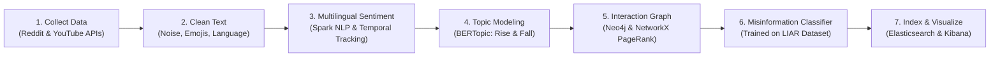

# Large-Scale Social Media Intelligence Platform

A comprehensive Data Science internship project implementing an end-to-end social media intelligence pipeline strictly adhering to project specifications.

The platform collects real-time social conversations from Reddit and YouTube, performs text cleaning and emoji handling, executes multilingual sentiment analysis tracked over continuous time intervals, models emerging and decaying topics using BERTopic, maps interaction networks and calculates PageRank influencer scores using Neo4j and NetworkX, trains a fake-news classifier on the LIAR benchmark dataset, and indexes enriched data into Elasticsearch with Kibana dashboards for search, trends, and alerts.

---

## Required Tech Stack

- **Reddit & YouTube APIs**: Data collection conforming to rate limits and terms of use.
- **Spark NLP**: Multilingual transformer sequence classification and temporal sentiment tracking.
- **BERTopic**: Topic discovery and dynamic topic modeling (`topics_over_time`).
- **NetworkX**: Directed graph analysis, PageRank influencer scoring, and community detection.
- **Neo4j**: Graph database for storing user interactions, posts, and replies.
- **Elasticsearch**: Distributed search engine with custom schema mappings and bulk indexing.
- **Kibana**: Visual dashboards for search, sentiment trends, topic evolution, and alerts.

---

## Step-by-Step Pipeline



### Step 1: Collect Data (Reddit and YouTube APIs)
- **Reddit Ingestion** (`data_collection/reddit_collector.py`): Fetches submissions and comment threads across targeted subreddits (`r/technology`, `r/datascience`, `r/machinelearning`, `r/worldnews`). Conforms strictly to Reddit API terms of use with custom `User-Agent` headers and rate limits.
- **YouTube Ingestion** (`data_collection/youtube_collector.py`): Searches videos and retrieves metadata and comment threads using the YouTube Data API v3 while respecting quota limits.
- **Raw Storage**: Raw, unaltered JSON payloads are preserved under `data/raw/reddit/` and `data/raw/youtube/`.
- *(Includes offline reference datasets corresponding to Dataset Option 1 / Option 5 for development when API keys are not supplied).*

### Step 2: Clean Text, Handle Emojis, and Detect Language
- **Noise Removal** (`preprocessing/text_cleaner.py`): Strips URLs, HTML markup and entity encodings, user mentions (`@user`, `u/user`, `r/sub`), and repeated punctuation.
- **Emoji Handling**: Demojizes emojis into textual tokens (e.g. `😊` becomes `:smiling_face_with_smiling_eyes:`) to preserve emotional semantics for downstream language models.
- **Language Detection**: Classifies the language of each post (e.g., `en`, `es`, `fr`, `de`, `hi`) using `langdetect` with confidence metrics.
- Output saved to `data/processed/clean_posts.json`.

### Step 3: Multilingual Sentiment Analysis & Temporal Tracking
- **Spark NLP Transformer Model** (`sentiment_analysis/sentiment_analyzer.py`): Classifies sentiment across multilingual records using transformer representations.
- **Sentiment Scoring**: Assigns sentiment labels (`positive`, `negative`, `neutral`), continuous scores in `[-1.0, 1.0]`, and prediction confidence.
- **Temporal Tracking**: Aggregates sentiment metrics across continuous time windows to calculate net sentiment indices:
  $$\text{Net Sentiment Index} = \frac{\text{Positive} - \text{Negative}}{\text{Total}}$$
- Output saved to `data/processed/posts_with_sentiment.json` and `data/processed/sentiment_trends.json`.

### Step 4: BERTopic Topic Discovery & Rise and Fall Tracking
- **Topic Extraction** (`topic_modeling/topic_modeler.py`): Utilizes BERTopic with SentenceTransformer embeddings to discover latent semantic themes and keywords across posts.
- **Dynamic Trajectories (`topics_over_time`)**: Computes topic frequency shifts across chronological bins, calculating velocity to determine which topics are **rising** vs. **falling**.
- Output saved to `data/processed/posts_with_topics.json` and `data/processed/topics_over_time.json`.

### Step 5: User-Interaction Graph in Neo4j & NetworkX Influencer Ranking
- **Neo4j Graph Construction** (`graph_analysis/neo4j_manager.py`): Creates `:User` and `:Post` nodes connected by `:AUTHORED`, `:REPLIED_TO`, and `:MENTIONED` relationships. Exports complete Cypher scripts (`data/processed/neo4j_graph_export.cypher`).
- **NetworkX Analytics** (`graph_analysis/networkx_analyzer.py`):
  - **PageRank Algorithm**: Calculates directed, weighted PageRank scores to identify high-authority influencers in the discussion network.
  - **Community Detection**: Partitions the interaction graph using greedy modularity to discover user clusters.
  - Syncs computed PageRank and community IDs back into user node attributes.
- Output saved to `data/processed/posts_with_graph_metrics.json` and `data/processed/influencer_rankings.json`.

### Step 6: Misinformation / Fake-News Classifier (LIAR Dataset)
- **Dataset**: Benchmarked on the PolitiFact LIAR dataset (`data/raw/liar_dataset.tsv`). Statements are mapped into binary classification: Misinformation (`pants-fire`, `false`, `barely-true`) vs. Credible (`half-true`, `mostly-true`, `true`).
- **Model Training** (`misinformation_detection/misinformation_classifier.py`): Trains a TF-IDF + Logistic Regression classification pipeline.
- **Evaluation**: Evaluated on test splits (Accuracy, Precision, Recall, F1 score).
- **Inference**: Scores social media posts with continuous misinformation risk probabilities (`[0.0, 1.0]`).
- Output saved to `data/processed/posts_with_misinformation.json` and serialized to `models/misinformation_classifier.pkl`.

### Step 7: Elasticsearch Indexing & Kibana Dashboards
- **Elasticsearch Indexing** (`indexing_and_dashboard/elasticsearch_indexer.py`): Defines an explicit index schema mapping (`social-intelligence-posts`) with keyword, text, date, and metric properties. Bulk indexes all enriched records and exports an NDJSON bulk ingestion file (`data/processed/elasticsearch_bulk.ndjson`).
- **Kibana Dashboards** (`indexing_and_dashboard/kibana_dashboard.json`): Pre-built Saved Objects containing:
  1. **Full-Text Search & Post Explorer**: Keyword query and sentiment filtering table.
  2. **Sentiment Dynamics Over Time**: Line chart tracking average sentiment and polarity over time.
  3. **Topic Evolution (Rise & Fall)**: Dynamic histogram showing post volumes across topics over time.
  4. **Influencer Leaderboard**: Table of ranked users by PageRank influence and community ID.
  5. **Misinformation Alerts**: Monitoring panel highlighting flagged high-risk claims.

---

## Project Structure

```
social-media-intelligence-platform/
├── config.py                          # Global configuration and path settings
├── docker-compose.yml                 # Local Neo4j, Elasticsearch, Kibana services
├── requirements.txt                   # Project Python dependencies
├── .env.example                       # API keys and environment variables template
├── main.py                            # Master 7-step pipeline orchestrator
├── data/
│   ├── raw/                           # Raw API JSON payloads (Step 1)
│   │   ├── reddit/
│   │   └── youtube/
│   └── processed/                     # Cleaned and enriched intelligence datasets
├── data_collection/                   # Step 1: Reddit & YouTube Collectors
│   ├── reddit_collector.py
│   ├── youtube_collector.py
│   └── collector_runner.py
├── preprocessing/                     # Step 2: Noise removal, Emojis, Language
│   └── text_cleaner.py
├── sentiment_analysis/                # Step 3: Spark NLP Multilingual Sentiment
│   └── sentiment_analyzer.py
├── topic_modeling/                    # Step 4: BERTopic Dynamic Topic Modeling
│   └── topic_modeler.py
├── graph_analysis/                    # Step 5: Neo4j Graph & NetworkX PageRank
│   ├── neo4j_manager.py
│   └── networkx_analyzer.py
├── misinformation_detection/          # Step 6: LIAR Fake-News Classifier
│   └── misinformation_classifier.py
├── indexing_and_dashboard/            # Step 7: Elasticsearch & Kibana Dashboards
│   ├── elasticsearch_indexer.py
│   └── kibana_dashboard.json
├── tests/                             # Unit tests for steps 1 through 7
│   ├── test_step1_collection.py
│   ├── test_step2_cleaning.py
│   ├── test_step3_sentiment.py
│   ├── test_step4_topics.py
│   ├── test_step5_graph.py
│   ├── test_step6_misinformation.py
│   └── test_step7_indexing.py
└── docs/                              # Project documentation & presentation
    ├── architecture.md
    ├── api_documentation.md
    ├── test_results.md
    └── presentation.md
```

---

## Setup and Installation

### 1. Prerequisites
- Python 3.11+
- (Optional for live containers) Docker & Docker Compose

### 2. Virtual Environment Setup
```powershell
# Navigate to project directory
cd social-media-intelligence-platform

# Create virtual environment and activate
python -m venv .venv
.venv\Scripts\activate

# Install dependencies
pip install -r requirements.txt
```

### 3. API Credentials (Optional)
If live API credentials are desired, copy `.env.example` to `.env` and fill in credentials:
```powershell
copy .env.example .env
```
*(If omitted, the platform gracefully uses realistic reference datasets for complete offline execution).*

### 4. Optional Services (Neo4j, Elasticsearch, Kibana)
To spin up local container instances:
```powershell
docker compose up -d
```
- **Neo4j Browser**: `http://localhost:7474`
- **Elasticsearch**: `http://localhost:9200`
- **Kibana**: `http://localhost:5601`

---

## Execution Guide

### Run All 7 Steps End-to-End
```powershell
python main.py --run-all
```

### Run Individual Steps
```powershell
# Step 1: Collect raw data
python data_collection/collector_runner.py --sources reddit youtube --limit 15

# Step 2: Clean text, handle emojis, detect language
python preprocessing/text_cleaner.py

# Step 3: Multilingual sentiment analysis & tracking
python sentiment_analysis/sentiment_analyzer.py

# Step 4: BERTopic dynamic topic modeling
python topic_modeling/topic_modeler.py

# Step 5: Neo4j interaction graph & NetworkX PageRank
python graph_analysis/networkx_analyzer.py

# Step 6: Train LIAR misinformation classifier
python misinformation_detection/misinformation_classifier.py

# Step 7: Index into Elasticsearch
python indexing_and_dashboard/elasticsearch_indexer.py
```

### Run Automated Tests
```powershell
python -m unittest discover -s tests -p "test_*.py" -v
```

---

## Kibana Dashboard Import Guide

1. Open Kibana in your browser (`http://localhost:5601`).
2. Navigate to **Management** > **Stack Management** > **Saved Objects**.
3. Click **Import** in the top right corner.
4. Select `indexing_and_dashboard/kibana_dashboard.json`.
5. Open the **Social Media Intelligence Platform Dashboard** to explore:
   - Search table for filtering posts and sentiment.
   - Sentiment Dynamics Over Time line charts.
   - Rising vs. falling topic histograms.
   - Influencer leaderboard (PageRank and communities).
   - Misinformation alert monitoring.
