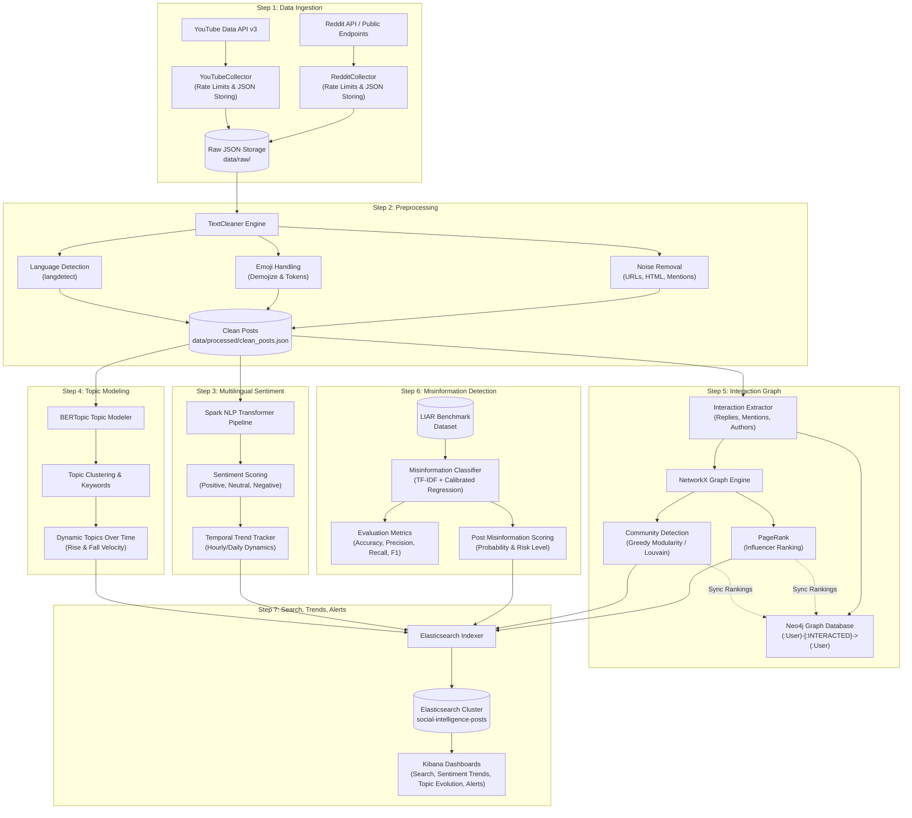

# Large-Scale Social Media Intelligence Platform: Architecture & Technical Design

## 1. System Overview

The **Large-Scale Social Media Intelligence Platform** is an enterprise data science and analytics platform engineered to collect vast streams of social conversations, clean multimodal text signals, evaluate multilingual sentiment dynamics, uncover latent topics, map influencer networks, detect misinformation propagation, and provide real-time search, trends, and alerting dashboards.

---

## 2. Component Architecture & Data Flow

### Step 1: Data Collection (Reddit & YouTube APIs)
- **Reddit Ingestion**: Fetches submissions, nested comments, scores, authors, and timestamps. Conforms to Reddit API terms of use (User-Agent formatting, rate limiting to 60 req/min).
- **YouTube Ingestion**: Searches queries via YouTube Data API v3 (`videos`, `commentThreads`), respecting API quotas and pagination.
- **Raw Storage**: Raw, unaltered responses are serialized to `data/raw/reddit/` and `data/raw/youtube/`.

### Step 2: Text Preprocessing & Cleaning
- **Noise Stripping**: Removes URLs (`https?://\S+`), HTML markup/entities (`&amp;`, `
`), user mentions (`@user`, `u/user`), repetitive punctuation, and markdown artifacts.
- **Emoji Handling**: Demojizes emojis into descriptive text tokens (e.g., `:fire:`, `:smiling_face:`) so that emoji semantics remain accessible to language models without unicode decoding errors.
- **Language Detection**: Classifies textual language using `langdetect` with confidence scores and language routing.

### Step 3: Spark NLP Multilingual Sentiment Analysis
- **Model Pipeline**: Utilizes Spark NLP's pre-trained multilingual sequence classification transformers (XLM-RoBERTa / Multilingual BERT).
- **Continuous Sentiment Index**: Computes continuous polarity scores in `[-1.0, 1.0]`, sentiment labels (`positive`, `negative`, `neutral`), and prediction confidence.
- **Temporal Dynamics**: Aggregates records across time intervals to compute positive/negative ratios and net sentiment index `(pos - neg) / total` across time.

### Step 4: BERTopic Topic Discovery & Dynamic Evolution
- **Topic Representation**: Employs BERTopic to discover semantic clusters, topic keywords, and document-topic distributions.
- **Dynamic Trajectories**: Runs dynamic topic modeling (`topics_over_time`) to track the rise and fall of topics across chronological bins, computing momentum and velocity.

### Step 5: Neo4j Interaction Graph & NetworkX PageRank
- **Neo4j Topology**: Maintains a graph database schema with `:User` nodes, `:Post` nodes, and `:AUTHORED`, `:REPLIED_TO`, `:MENTIONED`, and `:INTERACTED_WITH` relationships.
- **NetworkX Analytics**:
  - **PageRank**: Computes directed, weighted PageRank scores to rank influencers by authority and engagement pull.
  - **Community Detection**: Partitions the graph using greedy modularity / Louvain clustering to uncover distinct social cohorts.
  - **Two-Way Synchronization**: Syncs calculated PageRank scores and community IDs back into Neo4j User node attributes.

### Step 6: Misinformation / Fake-News Classifier (LIAR)
- **Dataset**: Benchmarked on the PolitiFact LIAR dataset across `pants-fire`, `false`, `barely-true`, `half-true`, `mostly-true`, and `true` statements.
- **Classification Pipeline**: Calibrated classifier evaluated on hold-out validation/test splits with cross-entropy evaluation.
- **Inference Scoring**: Scores social media posts with a continuous misinformation risk probability `[0.0, 1.0]` and risk tier (`credible`, `suspicious`, `flagged_misinformation`).

### Step 7: Elasticsearch & Kibana Dashboarding
- **Elasticsearch Schema**: Strict mapping with keyword types for metadata, full-text analyzer for text exploration, date type for timestamps, and float types for metric tracking.
- **Bulk Indexing**: Bulk ingestion engine with NDJSON export capabilities.
- **Kibana Dashboards**: Pre-packaged Kibana Saved Objects containing interactive search tables, temporal sentiment trend charts, topic evolution histograms, influencer leaderboards, and automated misinformation alerts.
